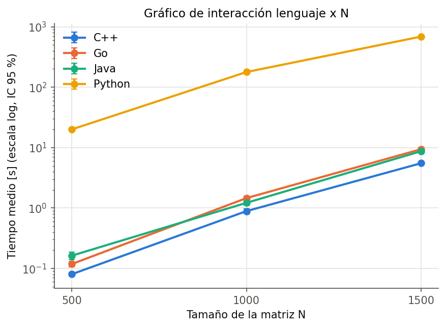
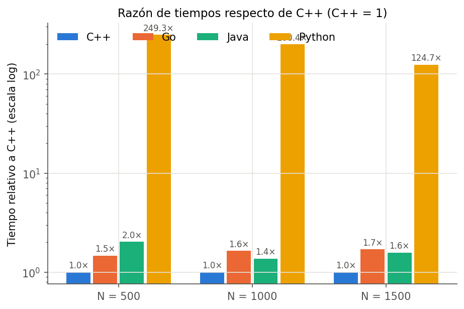

# Benchmark reproducible de multiplicación de matrices NxN en C++, Go, Java y Python

[](https://doi.org/PENDIENTE)
<!-- Semana 5: reemplazar PENDIENTE por el DOI entregado por Zenodo -->

Artifact científico del **Módulo 2 – Documentación de experimentos (Reproducibilidad y
Replicabilidad)**, curso *Experimentación Computacional* (Doctorado, USACH).
Se construye siguiendo la política
[ACM Artifact Review and Badging v1.1](https://www.acm.org/publications/policies/artifact-review-and-badging-current).

| Estado del artifact (autoevaluación ACM) | |
|---|---|
| Artifacts Evaluated – **Functional** | ✅ autoevaluado (Semana 3) – ver [docs/ACM_BADGES.md](docs/ACM_BADGES.md) |
| Artifacts Evaluated – **Reusable** | ✅ autoevaluado (Semana 4) |
| Artifacts **Available** | ⏳ pendiente de DOI en Zenodo (Semana 5) |
| Results **Reproduced** | ⏳ evaluación cruzada por un compañero (Semana 5) |

> La autoevaluación no equivale a un badge oficial: los badges ACM los otorga el comité de
> evaluación de artifacts de cada conferencia/revista.

> **¿Qué se hizo cada semana y cómo se demuestra?** Vea la [§13 Desarrollo por semana](#13-desarrollo-por-semana).
>
> **¿Solo quiere ejecutar los programas a mano?** Vea la guía simple [LEEME.md](LEEME.md).

---

## 1. Objetivo

Diseñar y ejecutar un experimento computacional **reproducible** que compare el tiempo de
ejecución del algoritmo **naive** de multiplicación de matrices cuadradas NxN implementado
de forma equivalente en **C++, Go, Java y Python**.

## 2. Pregunta de investigación

> ¿Existen diferencias estadísticamente significativas en el tiempo de ejecución del algoritmo
> naive de multiplicación de matrices NxN entre implementaciones equivalentes desarrolladas en
> C++, Go, Java y Python, y cómo varían estas diferencias según el tamaño de la matriz?

## 3. Hipótesis

- **H₀:** El lenguaje de implementación no produce diferencias estadísticamente significativas
  en el tiempo de ejecución del algoritmo de multiplicación de matrices.
- **H₁:** Al menos uno de los lenguajes presenta un tiempo de ejecución significativamente
  diferente de los demás.

Hipótesis complementaria (interacción): el efecto del lenguaje depende del tamaño N.

## 4. Variables

| Tipo | Variable | Niveles / unidad |
|---|---|---|
| Independiente (factor A) | Lenguaje de programación | C++, Go, Java, Python |
| Independiente (factor B) | Tamaño de la matriz N | 500, 1000, 1500 |
| Dependiente | Tiempo de ejecución de la multiplicación | segundos (`time_seconds`) |
| Controladas | Algoritmo (naive i‑j‑k), tipo `double`, matrices de entrada (SplitMix64, semilla 42), reloj monotónico, solo se mide la multiplicación, ejecución secuencial en contenedores | — |
| Registradas | CPU, RAM, SO, arquitectura, versiones de compiladores/VM | [results/environment/environment.md](results/environment/environment.md) |

## 5. Diseño experimental

Diseño **factorial completo 4 × 3** con **10 repeticiones** por celda → **120 mediciones**.

| Lenguaje | N = 500 | N = 1000 | N = 1500 | Total |
|---|---|---|---|---|
| C++ | 10 | 10 | 10 | 30 |
| Go | 10 | 10 | 10 | 30 |
| Java | 10 | 10 | 10 | 30 |
| Python | 10 | 10 | 10 | 30 |

- Análisis: **ANOVA de dos factores con interacción** (lenguaje, N, lenguaje×N) y
  **Tukey HSD** post‑hoc; verificación de supuestos (Shapiro‑Wilk, Levene); análisis
  complementario sobre log10(tiempo) y Kruskal‑Wallis por N.
- Protocolo detallado y justificación de equivalencia: [docs/PROTOCOLO.md](docs/PROTOCOLO.md).

## 6. Estructura del repositorio

```
.
├── README.md                  ← este documento (instrucciones de reproducción)
├── LICENSE / LICENSE-DATA     ← MIT (código) / CC BY 4.0 (datos y resultados)
├── CITATION.cff, .zenodo.json ← metadatos de cita y de publicación en Zenodo
├── CHANGELOG.md               ← historia de versiones por semana
├── config/config.yaml         ← parámetros del experimento (N, repeticiones, semilla, motor)
├── src/{cpp,go,java,python}/  ← las 4 implementaciones equivalentes
├── docker/<lang>/Dockerfile   ← entornos reproducibles (+ docker/analysis para estadística)
├── workflow/Snakefile         ← pipeline de automatización
├── workflow/profiles/default/ ← perfil Snakemake (ejecución secuencial)
├── scripts/                   ← integración, verificación, análisis, registro del entorno
├── results/
│   ├── raw/{cpp,go,java,python}.csv   ← resultados por lenguaje
│   ├── benchmark.csv                  ← resultados integrados
│   ├── verification/                  ← checksums y reporte de equivalencia
│   ├── analysis/{tables,figures}/     ← ANOVA, Tukey, tablas y gráficos
│   ├── analysis/reporte_estadistico.md
│   ├── environment/environment.md     ← hardware y versiones
│   └── logs/
└── docs/
    ├── semanas/                       ← enlaces al detalle por semana (README §13)
    ├── PROTOCOLO.md, ACM_BADGES.md, DATASHEET_FAIR.md, ZENODO.md
    ├── evaluacion-cruzada/            ← plantilla e informe de revisión cruzada
    └── presentaciones/
```

## 7. Requisitos

| Herramienta | Versión probada | Uso |
|---|---|---|
| Docker **o** Podman | Docker 29.4 / Podman 5.8 | construir y ejecutar los contenedores |
| Python | ≥ 3.11 (host) | solo para instalar Snakemake |
| Snakemake | 9.27.0 (`requirements-host.txt`) | pipeline |
| Linux x86_64 | Fedora 42 | (cualquier Linux con Docker debería funcionar) |

No se requiere instalar compiladores ni librerías en el host: todo se ejecuta en contenedores.
Hardware: ≥ 4 GB RAM libre; ~3 GB de disco para las imágenes. Duración total ≈ 1,5 h
(dominada por Python con N = 1500).

## 8. Reproducción completa (secuencia mínima)

```bash
# 0) Obtener el artifact
git clone https://github.com/Pmiqueles-usach/Modulo2-Inv-experimental.git
cd Modulo2-Inv-experimental

# 1) Construir MANUALMENTE las 5 imágenes desde los Dockerfile (no se usan imágenes publicadas)
docker build -f docker/cpp/Dockerfile      -t matmul-cpp:1.0 .
docker build -f docker/go/Dockerfile       -t matmul-go:1.0 .
docker build -f docker/java/Dockerfile     -t matmul-java:1.0 .
docker build -f docker/python/Dockerfile   -t matmul-python:1.0 .
docker build -f docker/analysis/Dockerfile -t matmul-analysis:1.0 .
#    (equivalente: scripts/build_images.sh)

# 2) Instalar Snakemake
python3 -m venv .venv && .venv/bin/pip install -r requirements-host.txt

# 3) Ejecutar TODO el flujo con un único comando
.venv/bin/snakemake --config results_dir=results_repro
```

> El repositorio ya contiene los resultados publicados en `results/`. Por eso, un simple
> `snakemake` responde "Nothing to be done". Para **reproducir** el experimento use un
> directorio nuevo (`results_dir=results_repro`) y compare con `results/`; para regenerar los
> resultados publicados, use `snakemake --forceall`.

Con **Podman** (o si el usuario no pertenece al grupo `docker`):

```bash
ENGINE=podman scripts/build_images.sh
.venv/bin/snakemake --config engine=podman results_dir=results_repro
# Si podman falla con "sd-bus call ... Input/output error" (sin sesión systemd):
ENGINE="podman --cgroup-manager=cgroupfs" scripts/build_images.sh
.venv/bin/snakemake --config engine="podman --cgroup-manager=cgroupfs" results_dir=results_repro
```

Prueba rápida (≈ 1,5 min) en un directorio separado, sin tocar los resultados publicados:

```bash
.venv/bin/snakemake --config results_dir=results_smoke 'sizes=[50,100]' repetitions=3
```

Para regenerar desde cero: `.venv/bin/snakemake --forceall`.

### Grafo del pipeline

```
run_benchmark(cpp|go|java|python) ─► raw/<lang>.csv ─► merge ─► benchmark.csv ─► analysis ─► tables/ figures/ reporte
                                 └─► verification/<lang>_checksum.csv ─► verify_equivalence ─► equivalence_report.md
environment ─► environment/environment.md

Antes de ejecutarse, cada regla comprueba que su imagen exista localmente; si falta, se detiene
e indica el comando `build` exacto.
```

`snakemake --dag | dot -Tpng > dag.png` genera el grafo real.

## 9. Ejecución local sin contenedores (Semana 2)

Si tiene instalados `g++`, Go ≥ 1.20, Java ≥ 11 y Python ≥ 3.9, puede compilar y ejecutar
las 4 implementaciones directamente:

```bash
scripts/semana2.sh                         # demo: N = 200,400 · 3 repeticiones (≈30 s)
scripts/semana2.sh 500,1000,1500 10 42     # experimento completo (≈1,5 h, dominado por Python)
```

El script compila cada programa, lo ejecuta, muestra los CSV y los tiempos medios, y verifica
que los 4 checksums sean idénticos. Los resultados quedan en `results_semana2/`. Sin `javac`,
usa `java MatMul.java` (modo archivo fuente).

## 9b. Ejecución manual por contenedor (sin Snakemake)

```bash
mkdir -p results/raw results/verification
docker run --rm --user "$(id -u):$(id -g)" --network none -v "$PWD/results:/results:z" matmul-cpp:1.0
docker run --rm --user "$(id -u):$(id -g)" --network none -v "$PWD/results:/results:z" matmul-go:1.0
docker run --rm --user "$(id -u):$(id -g)" --network none -v "$PWD/results:/results:z" matmul-java:1.0
docker run --rm --user "$(id -u):$(id -g)" --network none -v "$PWD/results:/results:z" matmul-python:1.0
```

Cada imagen ejecuta por defecto N = 500, 1000, 1500 con 10 repeticiones y semilla 42, y escribe
`results/raw/<lang>.csv` y `results/verification/<lang>_checksum.csv`. Los argumentos se pueden
cambiar: `docker run ... matmul-go:1.0 /results/raw/go.csv 200,400 5 42` o con
`scripts/run_container.sh <lang> [tamaños] [reps] [semilla]`.

### Demostración en consola (clase)

`scripts/demo.sh` recorre las 5 semanas con comandos visibles y pausas (≈3 min, en
`results_demo/`). Guía: [docs/DEMO.md](docs/DEMO.md).

## 10. Formato de los datos

`results/raw/<lang>.csv` y `results/benchmark.csv`:

| columna | tipo | descripción |
|---|---|---|
| `language` | texto | `cpp`, `go`, `java`, `python` |
| `N` | entero | tamaño de la matriz |
| `repetition` | entero | número de ejecución (1–10) |
| `time_seconds` | real | tiempo de la multiplicación en segundos (9 decimales) |

Descripción FAIR completa: [docs/DATASHEET_FAIR.md](docs/DATASHEET_FAIR.md).

## 11. Resultados

<!-- RESULTADOS:INICIO -->
Corrida oficial del 2026‑10‑17 (Intel Core Ultra 7 165H, 30 GB RAM, Fedora 42 / kernel 6.18,
Podman 5.8.2; entorno completo en [results/environment/environment.md](results/environment/environment.md)).
Duración total del pipeline: 2 h 33 min.

**Tiempo medio de la multiplicación [s] (10 repeticiones; entre paréntesis, razón respecto de C++)**

| N | C++ | Go | Java | Python |
|---|---|---|---|---|
| 500 | 0,080 | 0,118 (1,47×) | 0,163 (2,03×) | 20,0 (249×) |
| 1000 | 0,889 | 1,460 (1,64×) | 1,220 (1,37×) | 178,2 (200×) |
| 1500 | 5,519 | 9,415 (1,71×) | 8,724 (1,58×) | 688,5 (125×) |

**ANOVA de dos factores con interacción**

| Efecto | F (tiempo) | p (tiempo) | F (log10) | p (log10) | η² parcial (log10) |
|---|---|---|---|---|---|
| Lenguaje | 6091 | 2,8·10⁻¹²⁰ | 15 740 | 1,8·10⁻¹⁴² | 0,998 |
| N | 3109 | 3,5·10⁻⁹⁶ | 14 230 | 1,5·10⁻¹³¹ | 0,996 |
| Lenguaje × N | 2828 | 2,8·10⁻¹¹⁶ | 37,6 | 2,5·10⁻²⁴ | 0,676 |

**Conclusiones**

1. **Se rechaza H₀** (α = 0,05): el lenguaje produce diferencias significativas en el tiempo
   de ejecución. Tukey HSD encuentra diferencias significativas en **los 6 pares de lenguajes
   para cada uno de los 3 tamaños** (18/18 comparaciones); Kruskal‑Wallis lo confirma en cada N
   (p < 2·10⁻⁷).
2. **La interacción lenguaje × N es significativa**: la diferencia entre lenguajes depende del
   tamaño de la matriz. Se observa en dos hechos:
   - **Go y Java intercambian posiciones**: con N = 500 Go es más rápido que Java, mientras que
     con N = 1000 y 1500 Java supera a Go.
   - **La desventaja relativa de Python disminuye** al crecer N (249× → 125×). Una explicación posible es que, en los
     lenguajes compilados el costo de los accesos a memoria por columnas de B (fallos de caché)
     crecería más rápido que el costo del intérprete. Es una hipótesis plausible que este
     experimento no pone a prueba.
3. Orden de los lenguajes, de más rápido a más lento: C++ < Go < Java ≪ Python con N = 500;
   C++ < Java < Go ≪ Python con N = 1000 y 1500.
4. **Supuestos:** los residuos no son normales y las varianzas no son homogéneas, ni siquiera
   en log10 (Shapiro p = 0,002; Levene p < 10⁻⁵). Aun así, con diferencias de esta magnitud,
   el modelo log10 y la prueba no paramétrica llegan a la misma conclusión.
5. **Equivalencia funcional:** las 4 implementaciones producen la **misma matriz bit a bit**
   (checksums idénticos en los 3 tamaños,
   [equivalence_report.md](results/verification/equivalence_report.md)).
6. **Observación de estabilidad:** en Python con N = 1500, las repeticiones 7–10 fueron
   ~8 % más rápidas (634–667 s frente a 704–727 s). Es compatible con cambios de frecuencia o
   de carga del equipo durante una corrida de ~2 h; queda registrada como amenaza a la validez.

Reporte completo: [results/analysis/reporte_estadistico.md](results/analysis/reporte_estadistico.md)



<!-- RESULTADOS:FIN -->

## 12. Reutilización y extensión

- **Otros tamaños / repeticiones / semilla:** editar `config/config.yaml` o usar `--config`.
- **Agregar un lenguaje (p. ej. Rust):** crear `src/rust/`, `docker/rust/Dockerfile` respetando
  la interfaz `<salida.csv> <tamaños> <repeticiones> <semilla> [checksum.csv]` y el protocolo de
  [docs/PROTOCOLO.md](docs/PROTOCOLO.md), y añadir `rust` a `languages` en la configuración.
  `verify_equivalence` comprobará automáticamente que produce la misma matriz.
- **Otro análisis:** `scripts/analysis.py` lee cualquier `benchmark.csv` con las 4 columnas.

## 13. Desarrollo por semana

Cada semana del módulo se documenta aquí: qué pide el enunciado, qué se entregó, cómo
**ejecutarlo y demostrarlo en línea de comandos** y su autoevaluación ACM. Cada semana tiene su
etiqueta git (`git checkout semana-N` muestra el estado del artifact en ese momento).

| Semana | Tema | Objetivo ACM | Etiqueta git |
|---|---|---|---|
| [1](#131-semana-1--diseño-experimental-github-y-documentación) | Diseño experimental, GitHub y documentación | — | `semana-1` |
| [2](#132-semana-2--implementación-y-ejecución-del-experimento) | Implementación y ejecución | — | `semana-2` |
| [3](#133-semana-3--entorno-reproducible-docker-y-evaluación-functional) | Entorno reproducible (Docker) | Functional | `semana-3` |
| [4](#134-semana-4--automatización-snakemake-y-análisis-estadístico) | Snakemake + ANOVA/Tukey | Reusable | `semana-4` |
| [5](#135-semana-5--publicación-zenodo-y-evaluación-cruzada) | Zenodo (DOI) y evaluación cruzada | Available + Reproduced | `v1.0.0` |

> En los comandos, `docker` puede reemplazarse por `podman` (o por
> `podman --cgroup-manager=cgroupfs`, ver §8). La demostración de todas las semanas está en
> `scripts/demo.sh <semana>`: muestra cada comando antes de ejecutarlo, hace pausa entre pasos y
> escribe solo en `results_demo/`.

### 13.1 Semana 1 – Diseño experimental, GitHub y documentación

**Lo que pide el módulo**

- Repositorio GitHub como espacio de desarrollo, documentación y control de versiones.
- `README.md` inicial con objetivo, pregunta de investigación, H₀/H₁, variables y diseño
  experimental.
- Presentación de la propuesta (10 min) con comentarios sobre ACM Artifact Review & Badging.

**Entregables**

| Entregable | Ubicación | Estado |
|---|---|---|
| Repositorio GitHub | https://github.com/Pmiqueles-usach/Modulo2-Inv-experimental | ✅ |
| Objetivo, pregunta, hipótesis, variables y diseño | este README §1–5 | ✅ |
| Estructura del artifact (`src/`, `docker/`, `results/`, `docs/`) | §6 | ✅ |
| Comentarios sobre ACM | abajo y [docs/ACM_BADGES.md](docs/ACM_BADGES.md) | ✅ |
| Presentación de 10 minutos | [docs/presentaciones/](docs/presentaciones/) | ✅ |
| README original de la semana 1 | [docs/semanas/README_semana1_original.md](docs/semanas/README_semana1_original.md) | ✅ |

**Diseño experimental (resumen):** factorial completo 4 lenguajes × 3 tamaños N, 10 réplicas
por celda (120 observaciones); respuesta `time_seconds` (solo la multiplicación); controles:
mismo algoritmo naive, `double`, mismas matrices (semilla), reloj monotónico, ejecución
secuencial en contenedores; análisis: ANOVA de dos factores con interacción + Tukey HSD.

**Demostración en línea de comandos**

```bash
git remote get-url origin                    # repositorio GitHub
git log --oneline --decorate | tail -n 8     # historial y etiquetas por semana
sed -n '/^## 2. Pregunta/,/^## 6. Estructura/p' README.md   # pregunta, hipótesis, variables, diseño
scripts/demo.sh 1                            # lo mismo, guiado
```

**Comentarios sobre ACM Artifact Review & Badging**

1. **Terminología (v1.1, armonizada con NISO):** *repeatability* (mismo equipo y montaje),
   *reproducibility* (otro equipo, artifacts del autor), *replicability* (otro equipo,
   artifacts propios). La evaluación cruzada de la semana 5 corresponde a **reproducibilidad**.
2. **Badges independientes:** *Artifacts Evaluated* (Functional / Reusable), *Artifacts
   Available* y *Results Validated* (Reproduced / Replicated). El módulo los recorre en orden:
   Functional (S3) → Reusable (S4) → Available + Reproduced (S5).
3. **Functional** exige artifacts *documented, consistent, complete, exercisable* y evidencia de
   verificación: por eso se diseñó desde el inicio un **checksum** de la matriz resultado.
4. **Available** exige un repositorio de **archivo** con DOI: GitHub no basta, de ahí Zenodo.
5. **Results Reproduced** no exige igualdad exacta sino concordancia que no cambie las
   conclusiones: en un benchmark de tiempos se reproducen las decisiones estadísticas y el orden
   de los lenguajes, no los segundos absolutos.
6. **Crítica:** los badges evalúan el artifact, no la validez del diseño; por eso
   [docs/PROTOCOLO.md](docs/PROTOCOLO.md) documenta además las amenazas a la validez.

### 13.2 Semana 2 – Implementación y ejecución del experimento

**Lo que pide el módulo**

- Algoritmo naive NxN en C++, Go, Java y Python, funcionalmente equivalentes y sin librerías
  optimizadas.
- Matrices generadas con semilla; N = 500, 1000, 1500; 10 repeticiones; medir solo la
  multiplicación.
- Resultados en `cpp.csv`, `go.csv`, `java.csv`, `python.csv` con columnas
  `language,N,repetition,time_seconds`.
- Registrar el entorno (CPU, RAM, SO, arquitectura, versiones).

**Entregables**

| Entregable | Ubicación | Estado |
|---|---|---|
| Implementaciones | [src/cpp/](src/cpp/matmul.cpp), [src/go/](src/go/matmul.go), [src/java/](src/java/MatMul.java), [src/python/](src/python/matmul.py) | ✅ |
| Justificación de equivalencia y medición | [docs/PROTOCOLO.md](docs/PROTOCOLO.md), [docs/EXPLICACION_CODIGO.md](docs/EXPLICACION_CODIGO.md) | ✅ |
| CSV por lenguaje | [results/raw/](results/raw/) | ✅ |
| Verificación de equivalencia | [results/verification/equivalence_report.md](results/verification/equivalence_report.md) | ✅ |
| Registro del entorno | [results/environment/environment.md](results/environment/environment.md) | ✅ |
| Guía simple para compilar a mano | [LEEME.md](LEEME.md) | ✅ |

**Decisiones para asegurar comparabilidad:** mismo generador SplitMix64 en los 4 lenguajes (el
RNG nativo daría matrices distintas con la misma semilla); arreglo plano row-major; bucle
i-j-k con acumulador local; sin FMA (`-ffp-contract=off`) → resultados bit a bit idénticos;
matriz C reservada fuera del temporizador; optimización por defecto de cada ecosistema
(`-O2`, `go build`, HotSpot, CPython); calentamiento JIT de Java no descartado, se reporta.

Interfaz común: `<programa> <salida.csv> <tamaños> <repeticiones> <semilla> [checksum.csv]`.

**Demostración en línea de comandos** (requiere `g++`, Go, Java y Python en el host, ver §9)

```bash
# Compilar y ejecutar cada lenguaje a mano
g++ -O2 -ffp-contract=off -o matmul_cpp src/cpp/matmul.cpp && ./matmul_cpp cpp.csv 200 3 42
(cd src/go && go build -o ../../matmul_go .) && ./matmul_go go.csv 200 3 42
java src/java/MatMul.java java.csv 200 3 42
python3 src/python/matmul.py python.csv 200 3 42
head -n 4 cpp.csv go.csv java.csv python.csv

# Todo junto, con tiempos medios y verificación de checksums (≈30 s)
scripts/semana2.sh
```

### 13.3 Semana 3 – Entorno reproducible (Docker) y evaluación Functional

**Lo que pide el módulo**

- Cuatro imágenes Docker (C++, Go, Java, Python) con lo necesario para compilar/ejecutar,
  **construidas manualmente**.
- README con instrucciones claras para que un tercero ejecute el experimento hasta este punto.
- Cada ejecución genera su CSV independiente (`cpp.csv`, `go.csv`, `java.csv`, `python.csv`)
  con la estructura común `language,N,repetition,time_seconds`.
- Revisión del artifact con los criterios ACM para alcanzar *Functional* y demostración en
  clase con los contenedores.

**Entregables**

| Entregable | Ubicación | Estado |
|---|---|---|
| Dockerfile C++ (`gcc:14.2.0`) | [docker/cpp/Dockerfile](docker/cpp/Dockerfile) | ✅ |
| Dockerfile Go (`golang:1.23.4-bookworm`) | [docker/go/Dockerfile](docker/go/Dockerfile) | ✅ |
| Dockerfile Java (`eclipse-temurin:21.0.5_11-jdk`) | [docker/java/Dockerfile](docker/java/Dockerfile) | ✅ |
| Dockerfile Python (`python:3.12.8-slim-bookworm`) | [docker/python/Dockerfile](docker/python/Dockerfile) | ✅ |
| Construcción manual de las imágenes | [scripts/build_images.sh](scripts/build_images.sh), §8 | ✅ |
| Ejecución manual por contenedor | [scripts/run_container.sh](scripts/run_container.sh), §9b | ✅ |
| Autoevaluación *Functional* | tabla de abajo y [docs/ACM_BADGES.md §2.1](docs/ACM_BADGES.md) | ✅ |

**Decisiones de diseño de los contenedores**

- **Versiones exactas** de la imagen base (nunca `latest`).
- La imagen **compila el código durante el build**: el binario sale siempre del código versionado.
- `ENTRYPOINT` = programa; `CMD` = parámetros del experimento oficial → `docker run imagen`
  ejecuta el experimento completo sin argumentos.
- Resultados vía volumen `-v $PWD/results:/results:z` (`:z` para SELinux en Fedora/RHEL).
- `--user $(id -u):$(id -g)` (Docker) o `--userns=keep-id` (Podman): los CSV quedan a nombre
  del usuario.
- `--network none`: el experimento no requiere red.

**Demostración en línea de comandos**

```bash
# 1) Un Dockerfile: imagen base con versión exacta y compilación dentro del build
cat docker/cpp/Dockerfile

# 2) Construcción MANUAL de las 4 imágenes
docker build -f docker/cpp/Dockerfile    -t matmul-cpp:1.0 .
docker build -f docker/go/Dockerfile     -t matmul-go:1.0 .
docker build -f docker/java/Dockerfile   -t matmul-java:1.0 .
docker build -f docker/python/Dockerfile -t matmul-python:1.0 .
docker images --filter 'reference=*matmul-*'

# 3) Ejecución de cada contenedor → un CSV independiente por lenguaje (demo corta)
mkdir -p results_demo/raw results_demo/verification
for lang in cpp go java python; do
  docker run --rm --user "$(id -u):$(id -g)" --network none -v "$PWD/results_demo:/results:z" \
    matmul-$lang:1.0 /results/raw/$lang.csv 200,400 3 42 /results/verification/${lang}_checksum.csv
done

# 4) Misma estructura de columnas en los 4 CSV
head -n 4 results_demo/raw/*.csv

# 5) Evidencia de verificación: checksum idéntico en los 4 lenguajes
cat results_demo/verification/*_checksum.csv | grep -v '^language' | sort -t, -k2,2n | awk -F, '$3==1'
```

Guiado y con pausas (≈20 s de ejecución): `scripts/demo.sh 3`. Un solo lenguaje con otros
parámetros: `scripts/run_container.sh java 300 3 42 results_demo`.

**Autoevaluación *Functional***

| Criterio ACM | Cumple | Evidencia |
|---|---|---|
| Documented | ✅ | Inventario (§6) e instrucciones de construcción y ejecución (§8, §9b, esta sección) |
| Consistent | ✅ | Todo componente produce o analiza los resultados del experimento |
| Complete | ✅ | Sin dependencias externas no incluidas, salvo imágenes base oficiales con versión fija |
| Exercisable | ✅ | Los 4 contenedores se ejecutan y generan los 4 CSV |
| Evidencia de verificación | ✅ | Checksums idénticos entre lenguajes ([equivalence_report.md](results/verification/equivalence_report.md)) |

### 13.4 Semana 4 – Automatización (Snakemake) y análisis estadístico

**Lo que pide el módulo**

- Pipeline Snakemake que coordine los 4 contenedores (imágenes construidas manualmente;
  prohibido usar imágenes publicadas en registros).
- N = 500, 1000, 1500; 10 repeticiones; generar los 4 CSV e integrarlos en `benchmark.csv`.
- Análisis estadístico automático (ANOVA de dos factores con interacción y Tukey HSD) con
  tablas y gráficos.
- Dependencias explícitas entre etapas; un único comando o secuencia mínima documentada.
- Revisión ACM orientada a *Reusable*.

**Entregables**

| Entregable | Ubicación | Estado |
|---|---|---|
| Snakefile | [workflow/Snakefile](workflow/Snakefile) | ✅ |
| Perfil (ejecución secuencial) | [workflow/profiles/default/config.yaml](workflow/profiles/default/config.yaml) | ✅ |
| Parámetros | [config/config.yaml](config/config.yaml) | ✅ |
| Integración → `benchmark.csv` | [scripts/merge_results.py](scripts/merge_results.py) | ✅ |
| Análisis estadístico | [scripts/analysis.py](scripts/analysis.py), imagen [docker/analysis/](docker/analysis/) | ✅ |
| Reporte, tablas y gráficos | [results/analysis/](results/analysis/) | ✅ |
| Autoevaluación *Reusable* | [docs/ACM_BADGES.md §2.2](docs/ACM_BADGES.md) | ✅ |

**Reglas del pipeline**

| Regla | Entrada | Salida |
|---|---|---|
| `run_benchmark` | imagen del lenguaje | `raw/<lang>.csv`, `verification/<lang>_checksum.csv` |
| `merge` | 4 CSV | `benchmark.csv` |
| `verify_equivalence` | 4 checksums | `equivalence_report.md` |
| `analysis` | `benchmark.csv` | tablas, figuras, `reporte_estadistico.md` |
| `environment` | imágenes | `environment.md` |

Cada regla comprueba que su imagen `matmul-<x>:1.0` exista localmente; si no existe, se detiene
con el comando de construcción. Los benchmarks usan el recurso `benchmark_slot=1`: nunca corren
dos lenguajes a la vez.

**Análisis:** modelo `time ~ C(language) * C(N)` (ANOVA tipo II, η² parcial); supuestos con
Shapiro-Wilk y Levene; como los tiempos difieren en órdenes de magnitud, se ajusta también
sobre **log10(tiempo)** y se contrasta con Kruskal-Wallis por N; post-hoc Tukey HSD. Resultados
en §11.

**Demostración en línea de comandos**

```bash
.venv/bin/snakemake -n                              # plan de ejecución (dependencias)
.venv/bin/snakemake --dag | dot -Tpng > dag.png     # grafo del pipeline
# Ejecución completa con UN comando (configuración corta, sin tocar results/)
.venv/bin/snakemake --config results_dir=results_demo 'sizes=[100,200]' repetitions=3
head results_demo/benchmark.csv
sed -n '/^## 8. Decisión/,/^## 9/p' results_demo/analysis/reporte_estadistico.md
# Solo recalcula lo necesario
rm -f results_demo/benchmark.csv
.venv/bin/snakemake --config results_dir=results_demo 'sizes=[100,200]' repetitions=3
scripts/demo.sh 4                                   # lo mismo, guiado
```

### 13.5 Semana 5 – Publicación (Zenodo) y evaluación cruzada

**Lo que pide el módulo**

- Publicar una versión estable en **Zenodo** con DOI e incorporarlo al README.
- Contenido mínimo: código de los 4 lenguajes, README, Dockerfile, Snakefile, los 4 CSV,
  `benchmark.csv`, análisis estadístico, tablas y gráficos, licencia y mini datasheet FAIR.
- Evaluar el artifact de un compañero usando solo su artifact publicado, registrando
  dificultades, dependencias faltantes, ambigüedades, modificaciones y diferencias.
- Presentación final: resultados, artifact en Zenodo y experiencia de evaluación cruzada.

**Entregables**

| Entregable | Ubicación | Estado |
|---|---|---|
| Metadatos Zenodo | [.zenodo.json](.zenodo.json), [CITATION.cff](CITATION.cff) | ✅ |
| Procedimiento de publicación | [docs/ZENODO.md](docs/ZENODO.md) | ✅ |
| Verificación de contenido mínimo | [scripts/check_artifact.sh](scripts/check_artifact.sh) | ✅ |
| Licencias | [LICENSE](LICENSE) (MIT), [LICENSE-DATA](LICENSE-DATA) (CC BY 4.0) | ✅ |
| Mini datasheet FAIR | [docs/DATASHEET_FAIR.md](docs/DATASHEET_FAIR.md) | ✅ |
| Release `v1.0.0` y DOI | Zenodo · **DOI: PENDIENTE** | ⏳ |
| Plantilla de evaluación cruzada | [docs/evaluacion-cruzada/PLANTILLA_EVALUACION.md](docs/evaluacion-cruzada/PLANTILLA_EVALUACION.md) | ✅ |
| Evaluación del artifact de un compañero | `docs/evaluacion-cruzada/evaluacion-<compañero>.md` | ⏳ |
| Respuesta a la evaluación recibida | `docs/evaluacion-cruzada/respuesta-evaluacion.md` | ⏳ |

**Pasos:** (1) `scripts/check_artifact.sh` → todo `[ OK ]`; (2) seguir
[docs/ZENODO.md](docs/ZENODO.md) (release `v1.0.0` → DOI); (3) poner el DOI en este README,
CITATION.cff y el datasheet; (4) entregar el DOI al compañero evaluador; (5) evaluar el artifact
del compañero descargándolo **desde Zenodo**, con la plantilla.

**Demostración en línea de comandos**

```bash
scripts/check_artifact.sh                           # checklist del contenido mínimo
cat results/analysis/tables/speedup.md              # resultados oficiales
sed -n '/^## 8. Decisión/,/^## 9/p' results/analysis/reporte_estadistico.md
ls results/analysis/figures/
scripts/demo.sh 5                                   # lo mismo, guiado
```

## 14. Licencia y cita

- Código: [MIT](LICENSE). Datos, resultados, figuras y documentación: [CC BY 4.0](LICENSE-DATA).
- Cómo citar: ver [CITATION.cff](CITATION.cff) (DOI de Zenodo tras la Semana 5).

## 15. Referencias

- ACM. *Artifact Review and Badging – Current (v1.1)*. https://www.acm.org/publications/policies/artifact-review-and-badging-current
- National Academies of Sciences, Engineering, and Medicine (2019). *Reproducibility and Replicability in Science*. https://doi.org/10.17226/25303
- Fehr, J. et al. (2016). *Best Practices for Replicability, Reproducibility and Reusability of Computer-Based Experiments Exemplified by Model Reduction Software*. https://arxiv.org/abs/1607.01191
