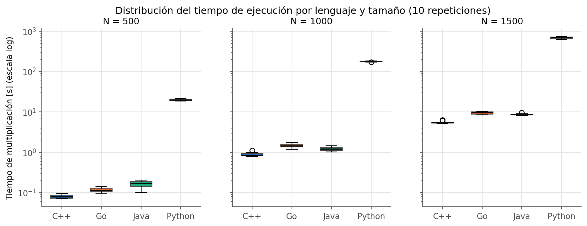
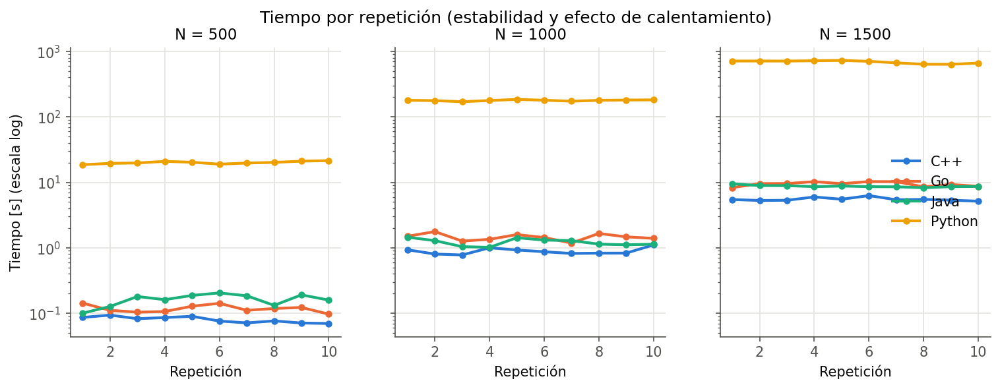
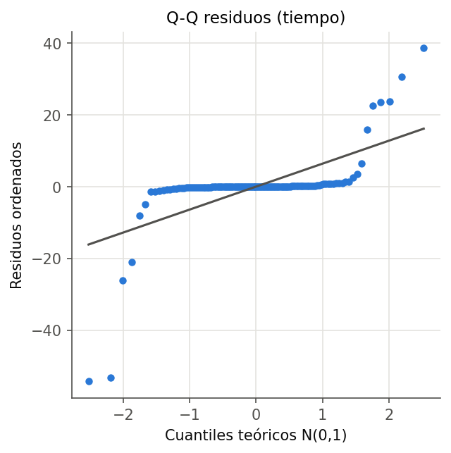
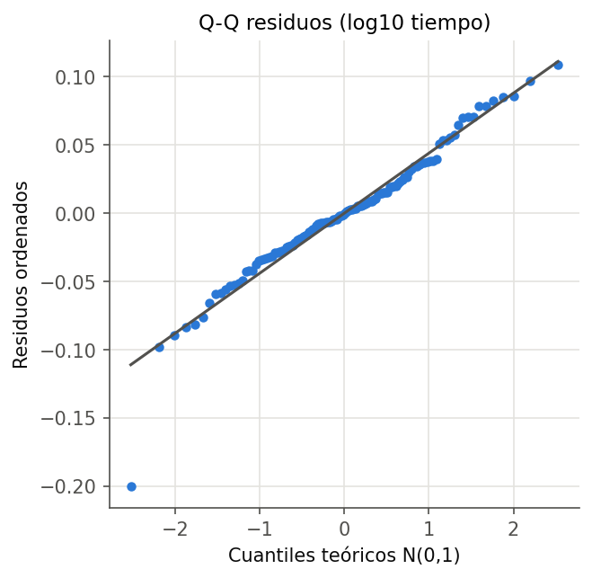

# Reporte estadístico del benchmark

- Observaciones: **120** (4 lenguajes × 3 tamaños × 10 repeticiones)
- Nivel de significancia: α = 0.05
- Modelo: ANOVA de dos factores con interacción, `y ~ Lenguaje + N + Lenguaje:N` (suma de cuadrados tipo II).
- Se reporta sobre el tiempo en segundos (especificación del módulo) y sobre log10(tiempo), transformación que estabiliza la varianza cuando los tiempos difieren en órdenes de magnitud.

## 1. Estadística descriptiva

| language   |    N |   n |   media_s |      de_s |   mediana_s |     min_s |     max_s |   cv_pct |   ic95_inf_s |   ic95_sup_s |
|:-----------|-----:|----:|----------:|----------:|------------:|----------:|----------:|---------:|-------------:|-------------:|
| cpp        |  500 |  10 |   0.08029 |  0.008557 |     0.07946 |   0.06979 |   0.09377 |   10.66  |      0.07417 |      0.08642 |
| cpp        | 1000 |  10 |   0.8889  |  0.1026   |     0.8498  |   0.7773  |   1.106   |   11.55  |      0.8155  |      0.9623  |
| cpp        | 1500 |  10 |   5.519   |  0.3412   |     5.435   |   5.151   |   6.264   |    6.182 |      5.275   |      5.763   |
| go         |  500 |  10 |   0.1182  |  0.01558  |     0.1145  |   0.09687 |   0.1427  |   13.17  |      0.1071  |      0.1294  |
| go         | 1000 |  10 |   1.46    |  0.1774   |     1.451   |   1.181   |   1.766   |   12.15  |      1.333   |      1.587   |
| go         | 1500 |  10 |   9.415   |  0.7225   |     9.54    |   8.3     |  10.26    |    7.673 |      8.898   |      9.932   |
| java       |  500 |  10 |   0.1628  |  0.03344  |     0.1707  |   0.1005  |   0.2046  |   20.55  |      0.1388  |      0.1867  |
| java       | 1000 |  10 |   1.22    |  0.1536   |     1.211   |   1.016   |   1.451   |   12.6   |      1.11    |      1.329   |
| java       | 1500 |  10 |   8.724   |  0.3296   |     8.61    |   8.256   |   9.493   |    3.778 |      8.489   |      8.96    |
| python     |  500 |  10 |  20.02    |  0.9188   |    19.94    |  18.58    |  21.44    |    4.59  |     19.36    |     20.67    |
| python     | 1000 |  10 | 178.2     |  4.133    |   178.9     | 170.1     | 184.6     |    2.32  |    175.2     |    181.1     |
| python     | 1500 |  10 | 688.5     | 35.29     |   707.7     | 634.2     | 727       |    5.126 |    663.2     |    713.7     |

## 2. Razón de tiempos respecto de C++

|    N |   cpp |   go |   java |   python |
|-----:|------:|-----:|-------:|---------:|
|  500 |     1 | 1.47 |   2.03 |      249 |
| 1000 |     1 | 1.64 |   1.37 |      200 |
| 1500 |     1 | 1.71 |   1.58 |      125 |

## 3. ANOVA de dos factores (tiempo en segundos)

|            |    sum_sq |   df |    F |       PR(>F) |   eta2_parcial |
|:-----------|----------:|-----:|-----:|-------------:|---------------:|
| Lenguaje   | 1.925e+06 |    3 | 6091 |   2.804e-120 |         0.9941 |
| N          | 6.549e+05 |    2 | 3109 |   3.516e-96  |         0.9829 |
| Lenguaje:N | 1.787e+06 |    6 | 2828 |   2.761e-116 |         0.9937 |
| Residual   | 1.138e+04 |  108 |  nan | nan          |       nan      |

## 4. ANOVA de dos factores (log10 del tiempo)

|            |   sum_sq |   df |           F |       PR(>F) |   eta2_parcial |
|:-----------|---------:|-----:|------------:|-------------:|---------------:|
| Lenguaje   | 102.7    |    3 |   1.574e+04 |   1.839e-142 |         0.9977 |
| N          |  61.89   |    2 |   1.423e+04 |   1.542e-131 |         0.9962 |
| Lenguaje:N |   0.4906 |    6 |  37.6       |   2.541e-24  |         0.6763 |
| Residual   |   0.2349 |  108 | nan         | nan          |       nan      |

## 5. Supuestos del ANOVA

| respuesta    |   shapiro_W |   shapiro_p |   levene_W |   levene_p |
|:-------------|------------:|------------:|-----------:|-----------:|
| time_seconds |      0.4355 |   1.777e-19 |      9.317 |  1.431e-11 |
| log10(time)  |      0.9621 |   0.00186   |      4.759 |  6.212e-06 |

Shapiro-Wilk evalúa la normalidad de los residuos; Levene (centrado en la mediana) la homogeneidad de varianzas entre las 12 celdas. Con n = 10 por celda el ANOVA es razonablemente robusto a desviaciones moderadas de normalidad, pero no a heterocedasticidad severa: por ello la inferencia principal se apoya en el modelo log10 y se contrasta con Kruskal-Wallis.

## 6. Tukey HSD: lenguajes dentro de cada N (log10 del tiempo)

|    N | group1   | group2   |   meandiff |   p-adj |   lower |   upper | reject   |
|-----:|:---------|:---------|-----------:|--------:|--------:|--------:|:---------|
|  500 | cpp      | go       |     0.167  |  0      |  0.0925 |  0.2415 | True     |
|  500 | cpp      | java     |     0.2997 |  0      |  0.2252 |  0.3743 | True     |
|  500 | cpp      | python   |     2.398  |  0      |  2.324  |  2.473  | True     |
|  500 | go       | java     |     0.1327 |  0.0002 |  0.0582 |  0.2073 | True     |
|  500 | go       | python   |     2.232  |  0      |  2.157  |  2.306  | True     |
|  500 | java     | python   |     2.099  |  0      |  2.024  |  2.173  | True     |
| 1000 | cpp      | go       |     0.215  |  0      |  0.1605 |  0.2696 | True     |
| 1000 | cpp      | java     |     0.1367 |  0      |  0.0822 |  0.1913 | True     |
| 1000 | cpp      | python   |     2.304  |  0      |  2.25   |  2.359  | True     |
| 1000 | go       | java     |    -0.0783 |  0.0024 | -0.1328 | -0.0238 | True     |
| 1000 | go       | python   |     2.089  |  0      |  2.035  |  2.144  | True     |
| 1000 | java     | python   |     2.168  |  0      |  2.113  |  2.222  | True     |
| 1500 | cpp      | go       |     0.2315 |  0      |  0.2009 |  0.2621 | True     |
| 1500 | cpp      | java     |     0.1993 |  0      |  0.1687 |  0.2299 | True     |
| 1500 | cpp      | python   |     2.096  |  0      |  2.066  |  2.127  | True     |
| 1500 | go       | java     |    -0.0322 |  0.036  | -0.0628 | -0.0016 | True     |
| 1500 | go       | python   |     1.865  |  0      |  1.834  |  1.895  | True     |
| 1500 | java     | python   |     1.897  |  0      |  1.866  |  1.927  | True     |

Pares **no** significativos: ninguno.

## 7. Robustez: Kruskal-Wallis por N

|    N |     H |   p_valor |
|-----:|------:|----------:|
|  500 | 34.82 | 1.328e-07 |
| 1000 | 34.39 | 1.64e-07  |
| 1500 | 33.99 | 1.987e-07 |

## 8. Decisión sobre las hipótesis

- Efecto principal del lenguaje (tiempo): F = 6091, p = 2.8e-120 → **se rechaza H₀**.
- Efecto principal del lenguaje (log10): F = 1.574e+04, p = 1.84e-142 → **se rechaza H₀**.
- Interacción lenguaje × N (tiempo): p = 2.76e-116; (log10): p = 2.54e-24. La diferencia entre lenguajes **depende del tamaño de la matriz** (ambos modelos).

## 9. Figuras

 
